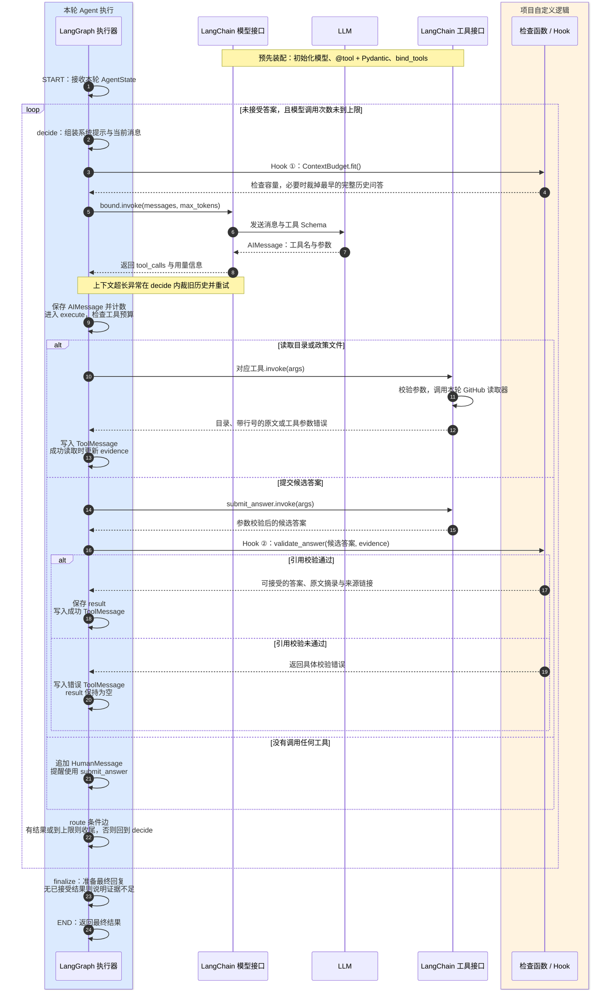

# Agent 内部机制：LangChain、LangGraph 与检查点

本文为中文文档。返回[中文文档目录](README.zh-CN.md)。

本图对应当前 `policy-agent-online-v2` 实现，参与者表示代码职责，不是独立部署的服务。
LangGraph 执行器一列包含我们定义的节点函数和条件路由。
图中的 Hook 是节点内显式调用的 Python 检查函数；当前没有注册 LangChain middleware
的 `before_model`、`wrap_tool_call` 等 Hook API，也没有单独的 Hook 服务。



## 框架和项目代码分别负责什么

| 部分 | 当前使用方式 | 具体职责 |
| --- | --- | --- |
| LangChain 模型接口 | `init_chat_model`、`bind_tools`、`bound.invoke` | 适配模型服务，把消息和工具 Schema 发送给模型，将响应表示为 `AIMessage` |
| LangChain 工具接口 | `@tool`、Pydantic `args_schema`、工具 `.invoke()` | 声明三个工具及参数约束，解析工具调用参数并调用对应 Python 函数 |
| LLM | 返回 `AIMessage.tool_calls` | 根据问题、目录和已读原文选择下一步工具及参数，或提交候选答案 |
| LangGraph | `StateGraph(AgentState)`、节点、边、`compile/invoke` | 传递本轮 State，按定义执行节点与循环 |
| 项目自定义逻辑 | `decide`、`execute`、`route`、`finalize` 等函数 | 系统提示、工具分发、预算、引用检查、错误反馈、结束条件和兜底回复 |

模型提出工具调用请求，`execute` 才执行工具。`bind_tools` 让模型看见工具 Schema，
不会替我们自动执行工具。当前没有使用 `create_agent`、`ToolNode` 或预置 Agent 循环。

官方接口参考：[LangChain 模型](https://docs.langchain.com/oss/python/langchain/models)、
[工具](https://docs.langchain.com/oss/python/langchain/tools)、
[LangGraph Graph API](https://docs.langchain.com/oss/python/langgraph/graph-api)、
[LangChain middleware hooks](https://docs.langchain.com/oss/python/langchain/middleware/custom)。

## LangGraph 的真实执行顺序

```text
START → decide → execute → route 条件边
                         ├─ 还需继续：decide
                         └─ 已接受答案或模型次数耗尽：finalize → END
```

图中只有 `decide`、`execute`、`finalize` 三个实际注册的节点。
`route` 是 `add_conditional_edges` 的路由函数，不是第四个节点。
节点函数返回 State 的字段更新；当前代码显式拼接并写回消息列表，没有使用
`add_messages` reducer 自动追加消息。

## 本轮 AgentState 中存什么

| 字段 | 用途 |
| --- | --- |
| `messages` | 历史问答、当前问题、本轮 AI 工具请求、工具结果和错误反馈 |
| `history_turns` | 当前仍保留多少个历史问答对，供整轮裁剪 |
| `evidence` | 本轮读取工具返回的原文及来源 ID；只有这里的来源能用于最终引用 |
| `read_calls`、`directory_calls`、`model_calls` | 分别限制读取尝试、目录请求和成功的模型响应次数 |
| `result` | 通过引用校验的最终候选；校验失败时保持为空 |
| `trace` | 轻量调用、读取、裁剪和校验事件；不是模型隐藏思维链 |
| `question` | 当前问题，供收尾回复语言判断等逻辑使用 |

每个用户问题创建新的图调用和 GitHub 读取器。历史只来自前端传来的最多 20 轮
完整问答，不导入上一轮的工具执行记录和证据。State 和文件缓存不跨请求保留。
普通聊天不返回或保存 trace；显式评测可以取出 trace 并写入合成测试报告。

## 两处 Hook 式检查点

| 检查点 | 实际位置 | 检查内容 | 未通过时 |
| --- | --- | --- | --- |
| ① 模型调用前 | `decide` 内的 `ContextBudget.fit()` | 系统提示、工具 Schema、历史、当前问题和本轮工具消息的容量，预留输出与安全余量 | 从最早的完整历史问答开始裁剪；没有历史可裁仍放不下则返回 422 |
| ② 接受候选答案前 | `execute` 内，`submit_answer.invoke()` 之后的 `validate_answer()` | 政策答案必须有引用；编号与引用列表对应；来源属于本轮已读证据；行号落在已读范围内，每条 1–80 行；后端提取原文并生成链接 | 返回具体工具错误，写入 `ToolMessage`；路由仍可回到 `decide` 让模型修正 |

问候、澄清、越界和证据不足等回复不应携带政策断言，也不接受政策引用。
引用检查验证来源和格式，不自动判断原文是否真的支持每句结论；语义支持需要 eval
进一步评估。

## 不同的重试与结束机制

- **工具参数或引用不合法**：返回工具错误消息，走 `execute → route → decide`。
  下次模型调用既能看到原来的工具结果，也能看到这次错误，修正后可重新提交。
- **服务商报告上下文超长**：`decide` 内部识别特定超限错误，删除一个最早历史问答对后
  重试，不经过 `execute`。每次都重新做预算；没有历史可裁则终止。这类被拒绝尝试
  不增加成功响应计数，另外记录裁剪事件。
- **模型 SDK 重试**：初始化传入 `max_retries=1`、`timeout=60`；具体哪些异常会重试由
  所选 provider SDK 决定，与上述业务循环分开。
- **GitHub 读取失败或其它未处理的模型请求错误**：向 API 层返回明确或经过清理的错误，
  不把它们当作引用校验失败无限要求模型补答。
- **模型不调用工具**：追加一条提醒使用 `submit_answer` 的 `HumanMessage`，仍受总次数限制。
- **收尾**：已接受 `result` 则返回；模型响应次数耗尽而没有结果时返回证据不足。

默认每题最多两次目录请求、六次文件读取尝试、十次成功的模型响应，单次模型响应
最多处理四个工具请求。工具错误和修正也消耗这些预算。
若同一批工具调用中已有答案被接受，剩余调用会收到跳过提示。

代码入口：[agent.py](../backend/policy_agent/agent.py)、
[chat.py](../backend/policy_agent/chat.py)、[context.py](../backend/policy_agent/context.py)、
[providers.py](../backend/policy_agent/providers.py)。
