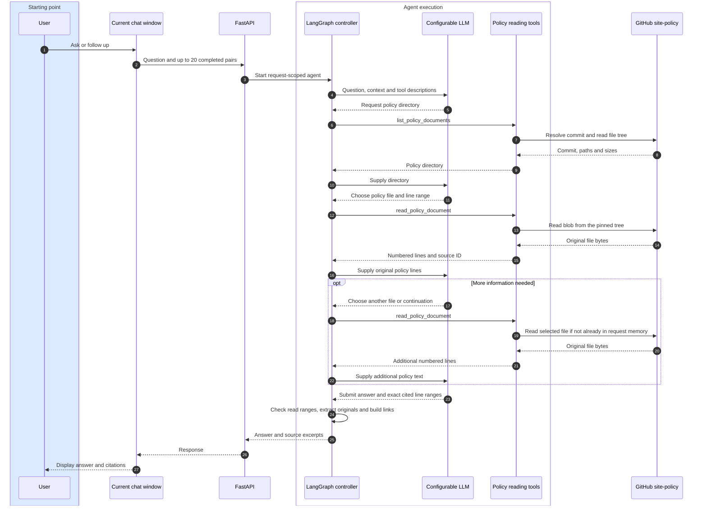

# Architecture and contracts

## Online file-reading interaction

The page owns temporary completed turns. Each backend request creates a fresh
LangGraph invocation and a GitHub reader; no local policy library, embeddings,
conversation store or persistent graph checkpointer is involved.

The LLM selects documents by path/name; no keyword/vector ranking or ingestion
chunking occurs. The same read tool continues long files by line range. The
controller repeats token budgeting before every LLM call, including after reads.

## GitHub source and lifetime

`PolicyRepository` talks only to the fixed public `github/site-policy` repository.
The first directory request resolves `POLICY_GITHUB_REF` (default `HEAD`) to a
commit, then lists its recursive tree. Only regular Markdown files under
`Policies/` are exposed. Truncated/empty directories fail explicitly. Reads accept
exact listed paths, not URLs, symlinks or traversal paths. The reader fetches the
listed blob SHA and checks its Git blob hash before returning original lines.

These operations use GitHub's official [commit](https://docs.github.com/en/rest/commits/commits#get-a-commit),
[tree](https://docs.github.com/en/rest/git/trees#get-a-tree) and
[blob](https://docs.github.com/en/rest/git/blobs#get-a-blob) read APIs.
No API request is made on page startup, imports or health checks. A greeting can
finish without touching GitHub. An optional independent read-only GitHub token
increases REST API limits; no model or GitHub credential enters prompts/responses.

Commit, directory and file bodies are cached only in this request's reader. Closing
the reader clears cached source text. Each subsequent question resolves a fresh
snapshot even when history was supplied. A full configured commit SHA provides
repeatability; moving refs may yield different snapshots on subsequent questions.
Original policy bytes, indexes, embeddings and chat records are never saved by the
application. Unused old local files are not consulted.

## Bounded tools and source citations

- `list_policy_documents()` returns paths/sizes and the immutable commit.
- `read_policy_document(path, start_line=1, line_count=200)` returns numbered
  original lines, a source ID, total lines and `next_start_line` for continuation.
- `submit_answer(kind, answer, citations)` supplies inline `[[1]]`, `[[2]]` markers
  and selected line ranges. The server assigns display labels and extracts text.

Defaults: six read attempts, two directory requests, ten successful model responses,
up to four tool calls per response. Read bodies are at most 200 lines / 24,000
characters, files at most 512 KB. HTTP responses and directory size are bounded.
Model-owned invalid tool requests receive safe correction messages; upstream errors
abort the request with a sanitized source error, not a policy answer from memory.

Each numbered citation entry must bind to a source ID read in the current
request. Multiple entries may select distinct passages from the same source ID.
Markers index that citation list and must match its entries; selected ranges must
lie within the returned read window and
span 1–80 lines. Excerpts are exact originals, with immutable commit/line URLs.
Prior answers are context only and cannot authorize a citation. Answered policy
claims require at least one current-turn read and citation. This validates
provenance, not semantic support. Conservative localized insufficient-evidence
text prevents unsupported claims being smuggled into a refusal.

## Temporary context

The frontend sends at most 20 completed question/answer pairs. The server uses all
when they fit; there is no fixed six-turn selection. Each model call counts system
text, tools, history, current question and current-turn messages, reserving output
and a safety margin. Oldest **whole historical pairs** are removed until estimated
input fits. Current-turn tool calls and results remain together. Recognized provider
context errors remove one more oldest pair and retry, bounded by remaining history.
If mandatory material cannot fit with no history, return 422.

The model context window is configurable; zero uses a LangChain profile or a
32,768-token fallback for unknown models. Output defaults to 2,048 tokens and is
also passed to the model; margin defaults to 512. Local estimates include a
non-ASCII allowance but are not exact vendor tokenization. Overflow retries can
handle underestimates; conservative estimates may trim earlier than necessary.
Authentication, rate-limit and transport errors do not trigger history trimming.

State is isolated per request, including evidence, budgets and optional traces.
Response metadata reports history received/used/trimmed counts. Backend trimming
does not alter the displayed frontend turns. There are no IDs for saved
conversations, cookies, local/session storage writes or cross-request agent traces.

## API and evaluation

`GET /api/health` reports backend configuration. `GET /api/policies` reports the
fixed repository and selected ref, without listing/fetching files. `POST /api/chat`
accepts `{content, history:[{question,answer}]}`. History fields are bounded and
cannot inject role/tool fields. Chat responses, including errors, use no-store.
The former knowledge-search, conversation CRUD and CLI/setup flows are removed.

Explicit evaluations hold expected original documents in evaluator memory and
write synthetic reports deliberately. The agent receives neither gold reference
text nor expected paths, and still selects/reads files online in each turn. Source
verification checks original lines and actual-read traces independently, including
alternative cited files outside the gold reference set. Evaluation reports distinguish
structural provenance/coverage from semantic correctness. Historical mixed-retrieval
reports are preserved, with their original failures.
