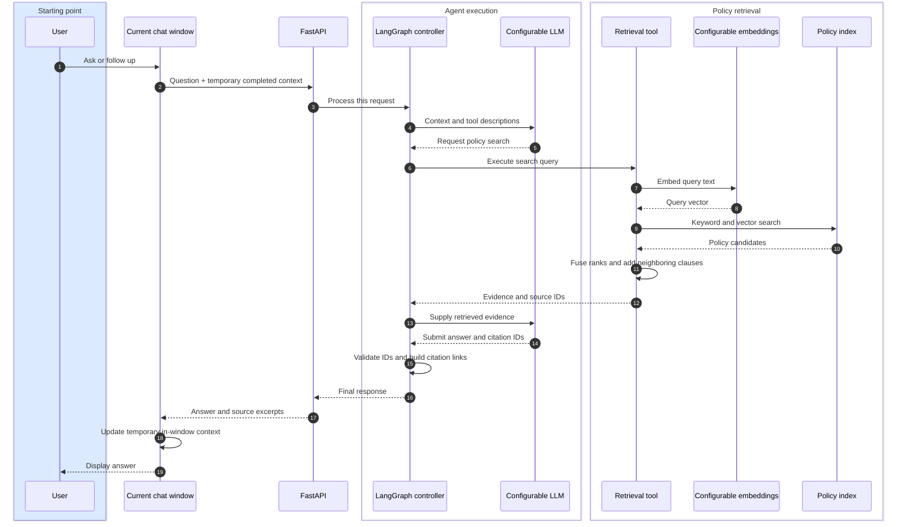

# Architecture and contracts

## Current interaction model — 2026-10-24

Web access only. The page owns completed turns in React memory; the server has no
conversation store, session identifier, shared chat memory or persistent checkpointer.
New tabs are empty. New chat, refresh, navigation away or window closure clears the
page state. Page exit aborts the client request and invalidates late responses; the
server may finish an already-running request, but never saves its dialogue.

The diagram describes the common hybrid path. Keyword mode omits query embeddings;
the model can search again within its budget or request clarification. Document
vectors are built ahead of time, not regenerated per question. Citation checking is
code inside the agent's submit-answer handling, not a separate AI verifier.

## Evidence and retrieval

`corpus.lock.json` fixes the Git source commit. Parsing preserves title, heading,
path, original line range, content hash and immutable GitHub URL. Chunk IDs include
source identity. Index replacement is transactional; dirty or mismatched source is
rejected. SQLite stores policy chunks, FTS5 and cached embeddings only.

Hybrid retrieval fuses up to 20 keyword and 20 semantic candidates using
`1/(60+rank)`, normally returning six seeds. The agent's search tool adds up to four
neighboring chunks from the top three seeds; at most ten pieces of evidence per
search. The public search API and retrieval benchmark do not add neighbors.

Embedding identity includes provider, model, endpoint, input hash and dimensions.
Incompatible indexes fail explicitly. Compatible adapters send raw text and request
float vectors. Chat and embedding services are independently configurable.

## Request-scoped agent

`ChatService.chat(question, history)` creates a fresh graph invocation. History is
caller-owned, limited to completed question/answer pairs, at most 20 pairs; the last
six enter model context by default. It is never used as policy evidence. No model
initialization or paid request occurs at import, health checks or corpus indexing.

The model calls `search_policies` and `submit_answer`; defaults are three searches
and six model calls per turn. State includes messages, evidence, counts and an
in-memory trace. Errors do not leave a partial turn behind. Separate requests do
not share messages, evidence or budgets; conversation locks are no longer needed.

Answered policy claims require current-turn retrieved IDs. The server rejects
unknown IDs, malformed markers and handwritten links, then creates numbered links
and exact excerpts. This checks provenance, not semantic support. For
`insufficient_evidence`, conservative localized text replaces model prose. Semantic
classification and unsupported generalizations remain known model-quality risks.

## API

| Method | Path | Contract |
| --- | --- | --- |
| GET | `/api/health` | Process/configuration status; `conversation_mode=window-memory` |
| GET | `/api/knowledge` | Source commit, document/chunk counts |
| POST | `/api/knowledge/search` | `{query, limit}` to inspect ranked evidence |
| POST | `/api/chat` | `{content, history:[{question,answer}]}` to process one turn |

All former `/api/conversations` create/list/get/delete/message routes are removed.
History fields are bounded (question 1–4,000 chars, answer 1–6,000 chars); role/tool
fields cannot be injected through the context schema. Empty requests or overlong
context return 422. Chat responses, including errors, use `Cache-Control: no-store`.
No cookies or browser local/session storage are used. The frontend blocks duplicate
submissions and clearing while a request is pending; it aborts and ignores responses
on page exit. Network retries cannot append to a hidden server-side conversation.

## Diagnostics, evaluation and scope

Responses include model/prompt/corpus metadata, request run ID, counts and latency.
Run IDs are diagnostic labels, not database keys. No ordinary chat/run/checkpoint
record is written. Explicit evaluations request a transient trace and write their
synthetic cases to reports; context resets between scenarios. Corpus copies keep
evaluation evidence stable.

Policy initialization uses `python -m policy_agent.setup {sync,index,embed,status}`.
There is no CLI chat or resumable terminal conversation. No authentication, admin
console or automatic summarization is included. Historical live reports and demo
captures predate this revised window-only interaction model.
