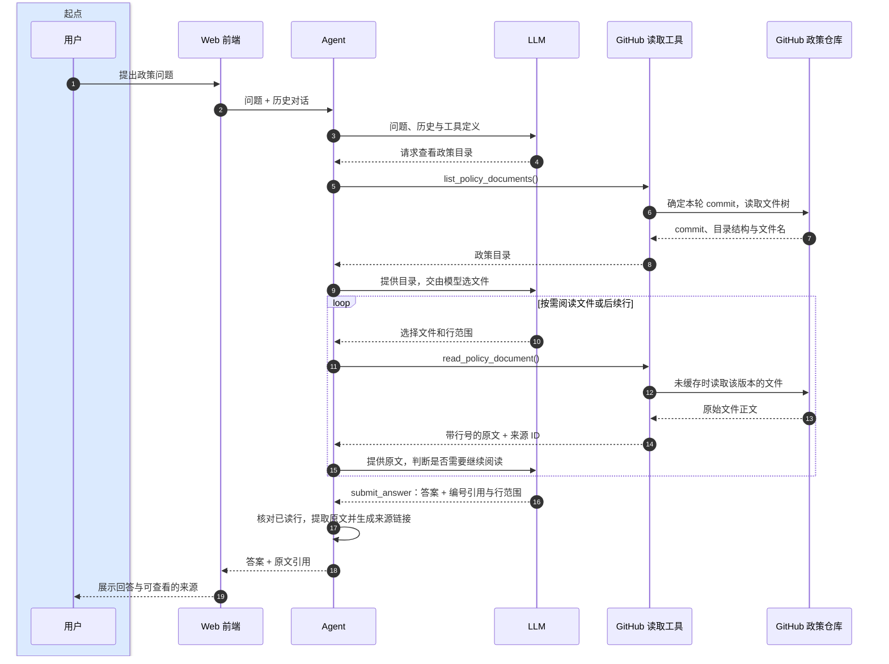

# 架构与接口约定

[English](ARCHITECTURE.md) | [简体中文](ARCHITECTURE.zh-CN.md) | [中文文档目录](README.zh-CN.md)

Agent 内部的框架职责、State、检查函数与重试机制见[Agent 内部机制图](AGENT_INTERNALS.md)。

## 在线读取时序图

页面管理临时的已完成问答。每次后端请求都创建新的 LangGraph 执行和 GitHub 读取器；
不使用本地政策库、Embedding、对话存储或持久化 Graph Checkpointer。

图中展示一次政策问答；FastAPI 将前端请求交给当前请求内的 LangGraph Agent。
重复阅读循环是示意：同一请求内已经打开的文件直接从内存读取，无需再请求 GitHub。
每次调用 LLM 前，Agent 都计算输入预算及输出预留；必要时删除最早的完整历史问答对。

LLM 按文件路径／名称选择文档；没有关键词／向量排序，也不进行入库切片。
长文件通过同一个读取工具按行范围继续读取。每次 LLM 调用前都会重新检查预算，包括读取文件之后。

## GitHub 来源与生命周期

`PolicyRepository` 只访问固定的公开仓库 `github/site-policy`。
首次目录请求将 `POLICY_GITHUB_REF`（默认 `HEAD`）解析为 commit，再读取该版本的递归文件树。
仅暴露 `Policies/` 下的普通 Markdown 文件；目录被截断或为空时明确报错。
读取只接受目录中列出的准确路径，不接受 URL、符号链接或路径穿越。
读取器按目录中的 blob SHA 获取内容，并校验 Git blob 哈希后返回原始行。

这些操作使用 GitHub 官方的 [commit](https://docs.github.com/en/rest/commits/commits#get-a-commit)、
[tree](https://docs.github.com/en/rest/git/trees#get-a-tree) 和
[blob](https://docs.github.com/en/rest/git/blobs#get-a-blob) 只读 API。
页面启动、模块导入或健康检查不会触发 GitHub API 请求；问候也可以不访问 GitHub。
可选的独立只读 GitHub token 用于提高 REST API 限额；模型或 GitHub 凭据不会进入 Prompt 或响应。

Commit、目录和文件正文只缓存在当前请求的读取器中。关闭读取器会清空来源文本缓存。
后续问题即使携带历史，也会重新确定快照。配置完整 commit SHA 可以复现同一版本；
使用会变化的 ref 时，不同问题可能读取不同快照。
应用不保存原始政策文件、索引、向量或聊天记录，也不会读取旧版遗留的本地文件。

## 工具预算与来源引用

- `list_policy_documents()` 返回路径／大小和不可变 commit。
- `read_policy_document(path, start_line=1, line_count=200)` 返回带行号原文、来源 ID、总行数及续读位置 `next_start_line`。
- `submit_answer(kind, answer, citations)` 提交 `[[1]]`、`[[2]]` 等正文标记和选定行范围；服务端生成显示编号并提取原文。

默认每次提问最多 6 次读取尝试、2 次目录请求、10 次成功模型响应；每次响应最多处理 4 个工具调用。
一次读取最多返回 200 行／24,000 字符，单文件最多 512 KB；HTTP 响应和目录大小也有限制。
模型提交无效工具请求时，会收到安全的纠错信息；上游失败则终止本轮并返回脱敏后的来源错误，
不会根据模型记忆生成政策答案。

每个编号引用必须绑定到本轮实际读取的来源 ID。同一来源 ID 可以有多个引用项，分别选择不同段落。
正文标记按引用列表位置编号，必须与列表匹配；所选范围必须落在实际返回的已读范围内，且包含 1–80 行。
摘录为准确原文，链接绑定不可变 commit 和行号。历史答案只作上下文，不能授权本轮引用。
政策回答至少需要一次本轮读取和引用。此机制验证来源真实性，不判断结论的语义支持。
本地化的保守“证据不足”预设文本，防止拒答夹带无依据政策结论。

## 临时上下文

前端最多发送 20 轮完整问答；容量允许时全部使用，不再固定只取 6 轮。
每次模型调用都计入系统提示、工具、历史、当前问题和本轮消息，并预留输出和安全余量。
删除最早的**完整历史问答对**，直到估算输入能放入窗口；本轮工具调用及其结果保持对应。
遇到可识别的服务商上下文超限错误时，再删除最早的一对历史并重试，次数受剩余历史数量限制。
历史删完后必要内容仍超限，则返回 422。

模型窗口容量可配置；设为 0 时优先读取 LangChain 模型规格，未知模型使用 32,768 tokens 的兜底值。
默认输出上限为 2,048 tokens，并作为参数传给模型；安全余量默认为 512。
本地估算包含非 ASCII 文本补偿，不是服务商的精确 tokenizer。
超限重试应对低估；保守估算可能提前裁剪。认证、限流或网络传输错误不会触发历史裁剪。

证据、预算和可选轨迹等状态按请求隔离。响应报告历史接收／使用／裁剪轮数。
后端裁剪不会影响前端显示的问答。没有已保存会话 ID、Cookie、local/session storage 写入或跨请求 Agent 轨迹。

## API 与评测

`GET /api/health` 返回后端配置；`GET /api/policies` 返回固定仓库和所选 ref，不列目录或下载文件。
`POST /api/chat` 接收 `{content, history:[{question,answer}]}`。
历史字段有长度限制，不能注入角色或工具字段。聊天响应（包括错误）均使用 no-store。
旧的知识检索、会话增删改查以及 CLI／初始化流程已移除。

显式运行的评测在评测器内存中保存预期原文，并主动写出合成场景报告。
被测 Agent 不会收到参考答案原文或预期文件路径，每轮仍自行在线选文件、读文件。
来源校验独立核对原文行和实际读取轨迹，也检查标准参考集之外的其他引用文件。
报告区分来源结构／覆盖指标和语义正确性；保留旧混合检索报告及其原始失败。
