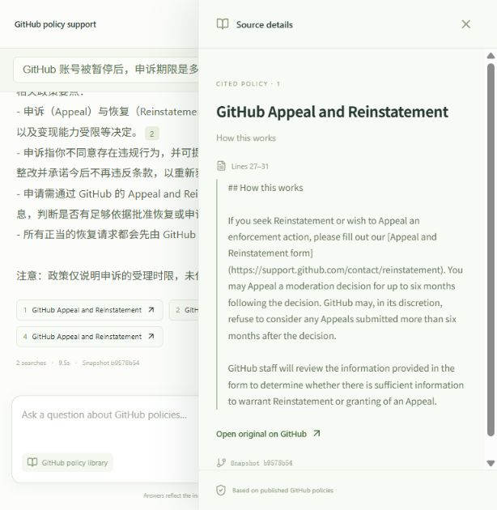
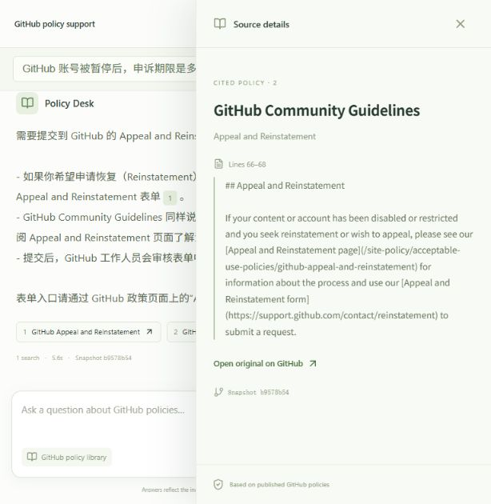

# Historical live browser demonstration

This capture predates the 2026-10-24 window-only change. Saved-history reopening
and the old UI controls are no longer current features.

2026-10-22, DeepSeek chat + Alibaba hybrid retrieval. These are real responses, not UI fixtures.

## Turn 1

User: GitHub 账号被暂停后，申诉期限是多久？请用中文回答。

根据 GitHub《申诉与恢复》(Appeal and Reinstatement) 政策：你可以在 GitHub 作出审核决定后的最长六个月内提出申诉（Appeal）；对于超过六个月才提交的申诉，GitHub 有权自行决定不予受理。[1]

相关政策要点：
- 申诉（Appeal）与恢复（Reinstatement）都适用于账号被停用/终止、内容被移除或访问受限、以及变现能力受限等决定。[2]
- 申诉指你不同意存在违规行为，并可提供额外信息以说明应有不同结论；恢复指你愿意作出必要整改并承诺今后不再违反条款，以重新获得账号或内容访问权。[2]
- 申请需通过 GitHub 的 Appeal and Reinstatement 表单提交，GitHub 工作人员会审核表单中的信息，判断是否有足够依据批准恢复或申诉。[1] [3]
- 所有正当的恢复请求都会先由 GitHub 工作人员审核，并给出决定。[4]

注意：政策仅说明申诉的受理时限，未保证任何特定的恢复结果。

- [1] [GitHub Appeal and Reinstatement](https://github.com/github/site-policy/blob/b9578b546d2506febda1da2cd7431644d58e512c/Policies/acceptable-use-policies/github-appeal-and-reinstatement.md#L27-L31)
- [2] [GitHub Appeal and Reinstatement](https://github.com/github/site-policy/blob/b9578b546d2506febda1da2cd7431644d58e512c/Policies/acceptable-use-policies/github-appeal-and-reinstatement.md#L14-L25)
- [3] [GitHub Acceptable Use Policies](https://github.com/github/site-policy/blob/b9578b546d2506febda1da2cd7431644d58e512c/Policies/acceptable-use-policies/github-acceptable-use-policies.md#L117-L128)
- [4] [GitHub Appeal and Reinstatement](https://github.com/github/site-policy/blob/b9578b546d2506febda1da2cd7431644d58e512c/Policies/acceptable-use-policies/github-appeal-and-reinstatement.md#L33-L37)

Searches: 2; latency: 9518ms.

## Turn 2

User: 那应该在哪里提交？

需要提交到 GitHub 的 Appeal and Reinstatement 表单（申诉与恢复表单）[1]。

- 如果你希望申请恢复（Reinstatement）或对一项执行措施提出申诉（Appeal），请填写 GitHub 的 Appeal and Reinstatement 表单[1]。
- GitHub Community Guidelines 同样说明：若内容或账号被停用/受限并希望申诉或恢复，请先查阅 Appeal and Reinstatement 页面了解流程，然后使用该表单提交请求[2]。
- 提交后，GitHub 工作人员会审核表单中的信息，判断是否有足够依据批准恢复或受理申诉[1]。

表单入口请通过 GitHub 政策页面上的“Appeal and Reinstatement form”链接进入。

- [1] [GitHub Appeal and Reinstatement](https://github.com/github/site-policy/blob/b9578b546d2506febda1da2cd7431644d58e512c/Policies/acceptable-use-policies/github-appeal-and-reinstatement.md#L27-L31)
- [2] [GitHub Community Guidelines](https://github.com/github/site-policy/blob/b9578b546d2506febda1da2cd7431644d58e512c/Policies/github-terms/github-community-guidelines.md#L66-L68)

Searches: 1; latency: 5603ms.

After refreshing the page, the saved conversation was selected again and both turns
were restored. Source [2] on the follow-up opened Community Guidelines lines 66–68:

