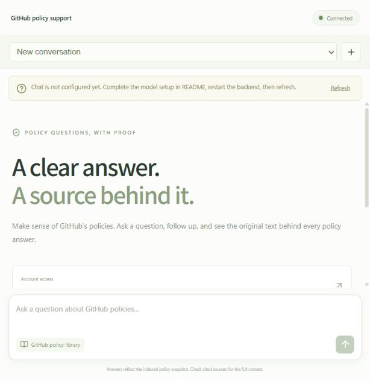

# Web interface

The React/TypeScript client is under `frontend/`. Vite provides development serving
and the API proxy; the production build is static and the Compose frontend image
uses Nginx to forward `/api`. Only the backend reads model credentials.

The interface uses a quiet green palette, a conversation sidebar, a central chat
workspace and a source-detail panel. It uses system font fallbacks and local SVG
icons; it has no remote font or image dependency. On narrow screens the sidebar
becomes a conversation selector and the source panel opens over the chat.

Implemented interactions:

- Suggested questions populate the composer without sending automatically.
- Enter submits, Shift+Enter adds a line, and IME composition is preserved.
- New conversations are created lazily on the first submitted question.
- Conversation titles come from the first completed user turn; empty chats stay untitled.
- Pending requests disable navigation and duplicate submission. Failed questions
  return to the composer; uncertain network outcomes prompt reopening history.
- Clicking a citation opens the exact original Markdown excerpt, heading, line range,
  fixed commit and original GitHub link. Text is rendered as text rather than raw HTML.
- Deletion shows a confirmation dialog with keyboard focus containment and Escape.
- Missing configuration and unreachable-server states are visible and retryable.

Validation performed with mocked API responses: six component tests cover suggestions,
follow-ups, source rendering, safe text display, deletion, retry, duplicate prevention
and initial server failures. Production build includes TypeScript checks.

The browser was also checked against the actual local backend in a narrow viewport:
corpus/setup status, suggested-question input, real missing-provider error, and
preservation of the failed question. A flex-layout issue hiding the header was found
and corrected during this check. Generated QA conversation data was removed.
A subsequent real DeepSeek/Bailian run verified two Chinese turns, citation
selection (including Community Guidelines lines 66–68), and reopening the saved
conversation after a page refresh. See the actual transcript in `DEMO.md`. No screenshots of fabricated model answers are used.

