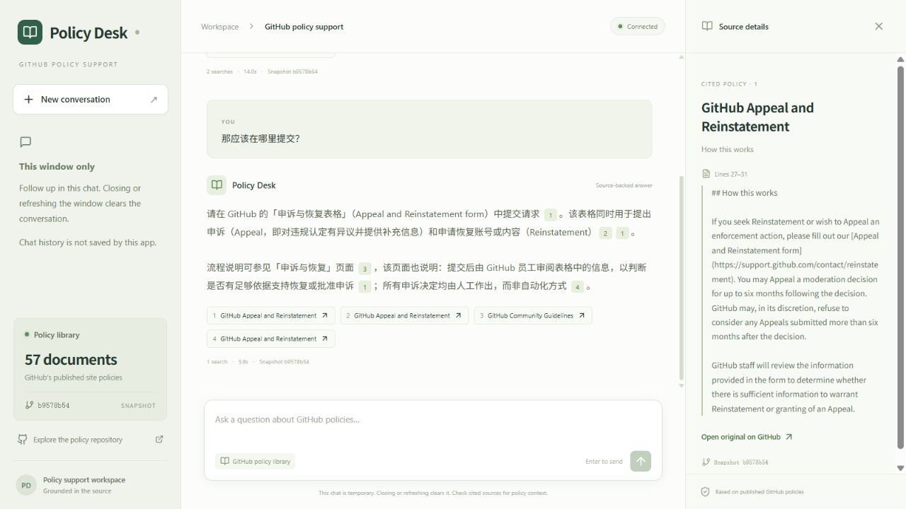
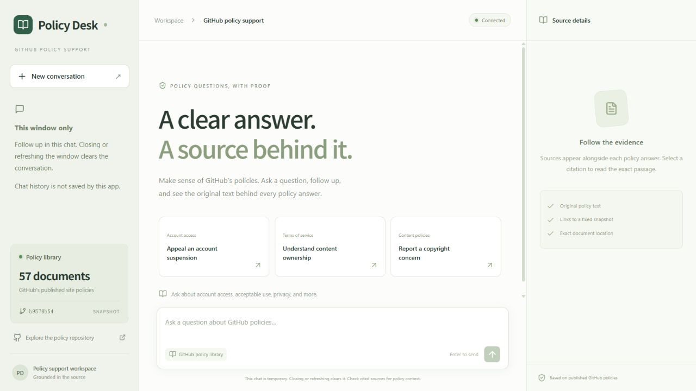
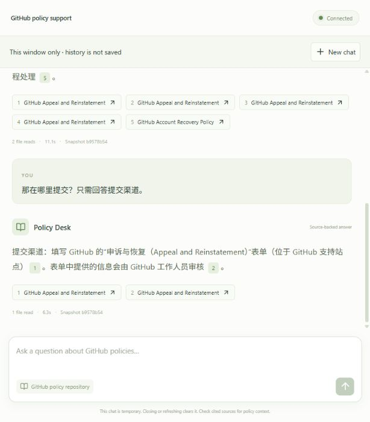
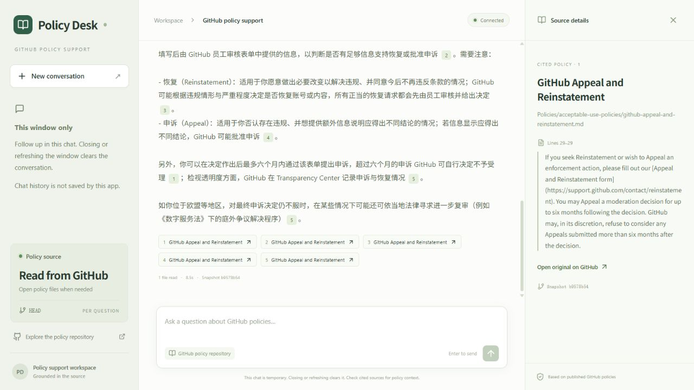

# Web interface — temporary conversations

[English](UI.md) | [简体中文](UI.zh-CN.md)

The React/TypeScript web client is the only conversation interface. It uses Vite's
API proxy in development and Nginx in Compose. Only the backend reads model keys.
The sidebar contains online policy-source information and a new-chat action; there is no
history list, saved-conversation picker, restore control or deletion dialog.

- Completed turns are held only in the current page's React memory. Follow-ups send
  their question/answer context to `/api/chat`. They never send saved conversation IDs.
- New windows/tabs are empty. Closing, navigating away, refreshing or choosing New
  conversation clears the chat. No localStorage, sessionStorage or cookie is used.
- Page exit cancels the browser request and discards late results. Request state and
  partial failures are not persisted on the server.
- Suggestions only populate the composer. Enter sends; Shift+Enter adds a newline;
  IME composition does not submit. Pending requests disable duplicates/new chat.
- Failed questions remain editable; only completed turns enter later context.
- Citation selection shows exact policy excerpts, headings, line ranges and fixed
  source links. Answer/source text is escaped rather than rendered as HTML.
- Model setup, GitHub source failures and server errors remain visible and recoverable.
- The source card shows online GitHub reading, not local document/chunk counts.
  Each answer identifies its immutable source commit and file-read count; citation
  panels show exact original-line excerpts. Greetings can have no source commit.

Tests cover in-window follow-ups, independent mounted windows, remount reset, new
chat reset, page exit during generation, retry, duplicate prevention, source rendering,
API context bounds and offline behavior. Prior screenshots showing persistent chat
history are historical and are superseded by the current design.

Browser acceptance on 2026-10-24 used a 1280×720 viewport: a real Chinese appeal
question and follow-up completed, a second tab started empty, refreshing cleared
both turns, and closing/reopening started empty. The input remained usable and
citation excerpts were visible. These captures show real API responses from the former local-policy architecture;
they predate the online-file-reading source card and are historical:

## Current online-reading capture

The online agent was checked again with a Chinese appeal question and an in-window
follow-up. The same file supports independently numbered passages; selecting a
citation shows the exact original lines. These are real API responses from the
current implementation at the browser's default 614x700 viewport:

